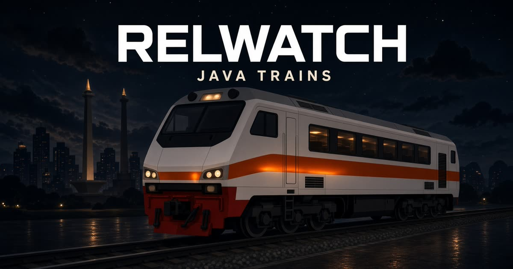

<div align="center">

<picture>
  <source media="(prefers-color-scheme: dark)" srcset="assets/logo-dark.png">
  
</picture>

# Relwatch

**Every train on Java, on one map: positions estimated from the GAPEKA 2026 timetable.**

[](https://github.com/ignitrondev/relwatch-releases/releases/latest)
[](https://github.com/ignitrondev/relwatch-releases/releases)
[](#install)
[](#how-it-works)
[](#how-it-works)
[](#features)

<a href="https://github.com/ignitrondev/relwatch-releases/releases/latest/download/relwatch.apk">
  
</a>
&nbsp;
<a href="https://relwatch.ignitrondev.space">
  
</a>

<br><br>



</div>

---

## Why Relwatch

Where is the train right now? Relwatch answers from the published timetable alone. No GPS feed, no account, no
waiting for a server: the whole GAPEKA 2026 schedule for Java ships inside the app, and an on-device engine turns it
into moving trains.

<table>
  <tr>
    <td align="center"><h3>2,089</h3>trains in GAPEKA 2026</td>
    <td align="center"><h3>48,685</h3>scheduled stops</td>
    <td align="center"><h3>466</h3>stations on Java</td>
    <td align="center"><h3>Per frame</h3>formation updates at close zoom</td>
  </tr>
</table>

## Features

| | |
|---|---|
| 🗺️ **Network map** | Every running train on Java, colored by service class, filterable, moving on real track geometry. |
| 🚆 **Formation view** | Zoom in and a dot becomes the train itself: locomotive, executive, dining, power car, or the KRL trainset, car by car. |
| 🕒 **Station boards** | Arrivals and departures for any station, with the trains still to come. |
| 📍 **Trip details** | Every stop, the estimated position along the route, and the trains it meets on the way. |
| 🔎 **Search** | By train number or name, station code or name. |
| 📴 **Offline timetable** | Schedule and computation run on the device; only the basemap needs a connection. |
| 🔔 **In-app updates** | Relwatch checks this repository and tells you when a new version is out. |
| 🌗 **Light and dark** | Follows your system theme, with Material You accents on Android 12+. |

## How it works

```text
GAPEKA 2026 timetable ──▶ ignitrondev-core (on-device engine) ──▶ map, boards, trips
                           ├─ km(t) curve through every timetable point
                           ├─ accelerate · cruise · brake per traction class
                           ├─ section speed limits and published formations
                           └─ positions snapped to OpenStreetMap track
```

The timetable takes effect on **1 December 2026**. Before that date trains still run on the previous timetable, so
Relwatch shows the network map only and switches on train positions on the day.

> [!IMPORTANT]
> Positions are **estimates from the schedule**, not live tracking. Delays, extra trains and cancellations announced
> by the operator are not reflected. Relwatch is an independent project and is **not affiliated with PT Kereta Api
> Indonesia (KAI)**.

## Install

1. Download [`relwatch.apk`](https://github.com/ignitrondev/relwatch-releases/releases/latest/download/relwatch.apk) on your Android phone.
2. Open it. If asked, allow installs from your browser or file manager.
3. Tap **Install**, then open Relwatch.

Requirements: Android 8.0 or newer, 64-bit ARM, about 21 MB.

<details>
<summary><b>Verify the download</b></summary>

<br>

Every release is signed with the same key. Check the certificate before installing:

```sh
apksigner verify --print-certs relwatch.apk
# Signer #1 certificate SHA-256 digest:
# f03234029aaf41d431793aeb1c2b976806b60b8fc630bfd4d8b5ca2809d173c0
```

The SHA-256 of each APK is listed in its [release notes](https://github.com/ignitrondev/relwatch-releases/releases).

</details>

## Changelog

What changed in each version: [CHANGELOG.md](CHANGELOG.md) (format: [Keep a Changelog](https://keepachangelog.com/en/1.1.0/)).

## Feedback

Found a train in the wrong place, a bug, or want a feature? Send it from the
[feedback form](https://relwatch.ignitrondev.space/#masukan). Every message is read.

## Support

Relwatch is free and built by an independent engineer. Support helps it reach Google Play and keep improving.

<a href="https://saweria.co/bimaadam">
  
</a>

---

<div align="center">
<sub>
This repository holds release builds only; the source code is not published.<br>
Track geometry © OpenStreetMap contributors (ODbL). Basemap by OpenFreeMap.<br>
© 2026 ignitrondev
</sub>
</div>
